# Database

Supabase Postgres. The schema lives in `supabase/migrations/`, applied in order.

| Migration | Contents |
| --- | --- |
| `…0100_foundation` | Enums, `private` schema, `updated_at` trigger |
| `…0200_accounts_memberships` | Profiles, roles, Shopify identity links, memberships, audit log, webhook log, `tier_features`, tier and admin functions |
| `…0300_sports_reference` | Data sources, venues, teams, players, external IDs, games, results, box scores |
| `…0400_markets_injuries` | Sportsbooks, prop markets, odds snapshots (line movement), current lines, prop odds, injury reports |
| `…0500_models_projections` | Model versions, team ratings, game and player projections, injury impacts, graded results, model performance view, daily insights |
| `…0600_user_features` | Watchlists, alert rules |
| `…0700_row_level_security` | Grants, RLS policies, function permissions |
| `…0800_reference_taxonomy` | Prop market categories |

## Relationships

```mermaid
erDiagram
  auth_users ||--|| profiles : "id"
  profiles ||--o{ customer_identities : "Shopify customer GID"
  profiles ||--o{ memberships : "plus / pro"
  memberships ||--o{ membership_events : audit
  profiles ||--o{ user_roles : admin
  profiles ||--o{ watchlists : owns
  watchlists ||--o{ watchlist_items : contains
  profiles ||--o{ alert_rules : owns

  teams ||--o{ players : "current team"
  venues ||--o{ games : hosts
  teams ||--o{ games : "home / away"
  games ||--o| game_results : final
  games ||--o{ team_game_stats : ""
  games ||--o{ player_game_stats : ""
  games ||--o{ odds_snapshots : "line history"
  games ||--o{ market_lines_current : "latest line"
  games ||--o{ player_prop_odds : ""
  players ||--o{ injury_reports : ""
  data_sources ||--o{ games : "provenance"

  model_versions ||--o{ game_projections : produced
  model_versions ||--o{ player_projections : produced
  model_versions ||--o{ team_ratings : produced
  games ||--o{ game_projections : ""
  game_projections ||--o| game_projection_details : "Plus fields"
  players ||--o{ player_projections : ""
  player_projections ||--o| player_projection_distributions : "Pro fields"
  team_ratings ||--o| team_rating_components : "Pro fields"
  injury_reports ||--o{ injury_impacts : ""
  game_projections ||--o{ prediction_results : graded
  player_projections ||--o{ prediction_results : graded
```



## Rules the schema enforces

- **League consistency:** a game's teams, a player's team and an injury's player and team must all be in the same league (composite foreign keys on `(id, league)`).
- **Provenance:** games, results, box scores, odds and injuries require a `source_id`. Nothing can be stored without naming the feed it came from.
- **Odds shape:** spreads need a line, totals need over and under prices, moneylines need no line, and every price must be valid American odds.
- **Opening and closing lines:** at most one of each per game, book and market.
- **Unvalidated models can't publish:** a trigger blocks `published_at` on projections, ratings and injury impacts unless the model version is `validated`. Development models can still write rows for backtesting.
- **Memberships:**
  - Free is never stored; it's the absence of a paid row.
  - Shopify rows need a contract GID, and admin rows need an attribution.
  - Cancelled rows need an end date.
  - Every change is written to `membership_events`.

## Plans in the database

`tier_features` is the database copy of `MIN_TIER` in `src/lib/entitlements.ts`. Policies call `private.has_feature('<feature>')`. `npm run check:entitlements` fails if the two files disagree.

Premium fields are split into their own tables, so each table maps to exactly one feature:

| Table | Feature | Plan |
| --- | --- | --- |
| `game_projections` | `games.basicProjections` | Free |
| `game_projection_details` | `games.projectedScores` | Plus |
| `odds_snapshots` | `games.lineMovement` | Plus |
| `injury_impacts` | `injuries.adjustments` | Plus |
| `player_projections`, `player_prop_odds` | `props.projections` | Plus |
| `player_projection_distributions` | `props.advanced` | Pro |
| `team_rating_components` | `ratings.advanced` | Pro |
| `prediction_results`, `model_performance` | `history` | Pro |

The Free Edge Finder limit (edges on the first two games) is a display limit enforced by the app's data layer, as in Phase 1. Free viewers can already see each game's model line and current market line.

## Effective tier

`private.effective_tier(user)` takes the highest tier among the user's memberships that are:

- in status `active`, `trialing`, `past_due`, or `cancelled` with an end date still ahead, and
- started, and
- not more than 3 days past `current_period_end`.

Anything else resolves to `free`. The app reads it through `public.effective_tier_for()` (service role only); clients can call `public.my_tier()` for themselves.

## Admin

- Admins are rows in `user_roles`, inserted with the service role (the Supabase SQL editor). There's no API path to create one.
- Admins call `admin_grant_membership(user, tier, period_end, note)` and `admin_end_membership(membership, note)`.
- Admins can't edit membership rows directly, and can't end Shopify-managed memberships.

## Applying migrations

```bash
npx supabase login
npx supabase link --project-ref <project-ref>
npx supabase db push          # applies supabase/migrations
```

Then make yourself an admin in the SQL editor, after your first login creates your profile:

```sql
insert into public.user_roles (user_id, role, note)
values ('<your profile id>', 'admin', 'owner');
```

## Tests

`npm run db:test` runs every migration on a scratch database and then runs `supabase/tests/rls_test.sql`. The suite has 94 checks across visitors, Free, Plus, Pro, lapsed and cancelled members, admins and the service role. It needs a local Postgres 15+ superuser connection (`PGHOST`, `PGPORT`, `PGUSER`), and `supabase/tests/supabase_shim.sql` stands in for Supabase's roles and `auth` schema.
